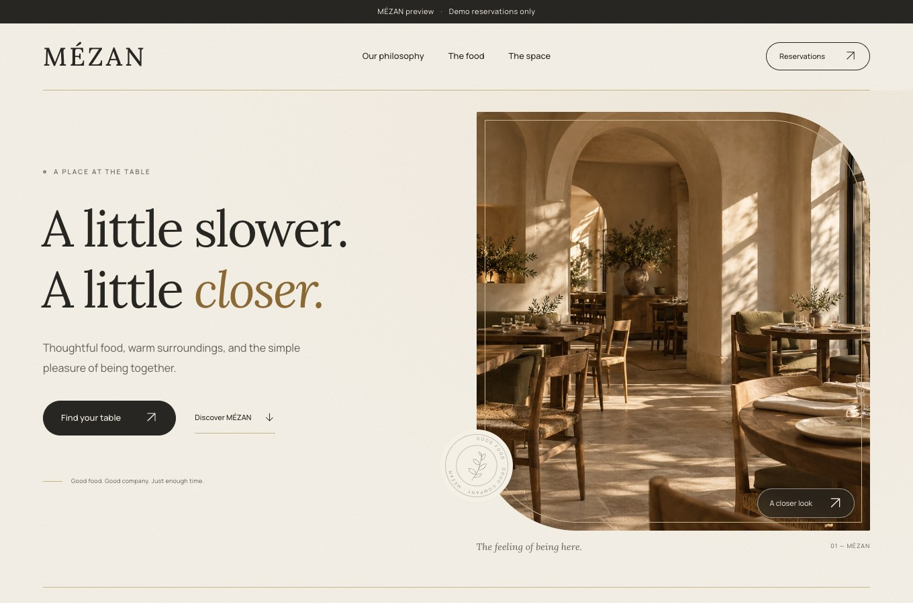
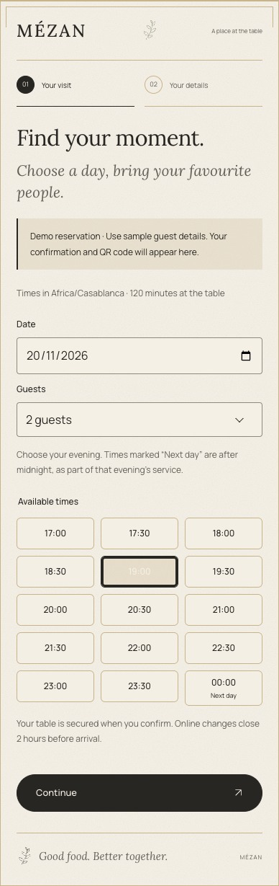
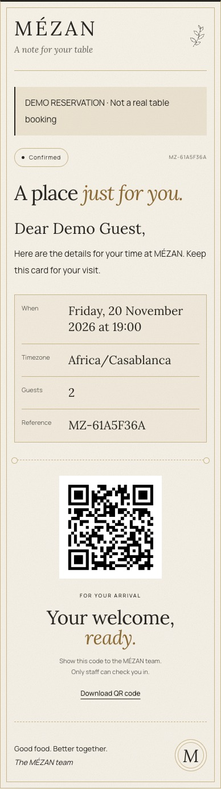
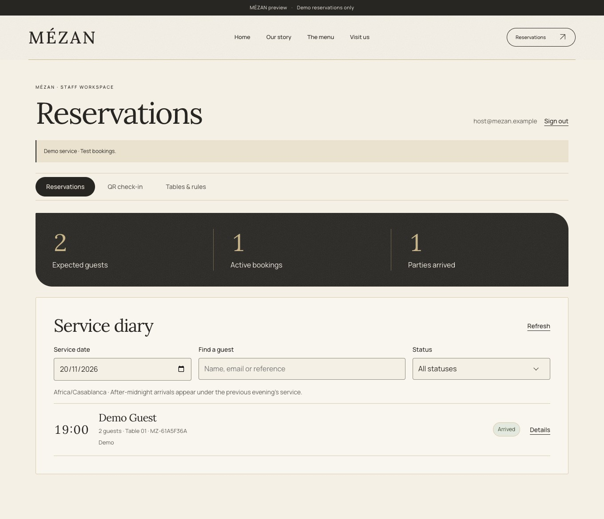

# MÉZAN

A restaurant website with mobile reservations, QR confirmation cards, and a staff dashboard for check-in.

## From booking to check-in

| Mobile booking | QR confirmation |
| --- | --- |
|  |  |

## Demo walkthrough

1. The guest selects a date, party size, and time, then confirms with sample contact details.
2. The confirmation card shows the reservation reference and a downloadable QR code. The guest can also reschedule or cancel from this card.
3. Staff scan the QR code or enter the booking reference, review the details, and confirm arrival. The reservation then appears as **Arrived** in the dashboard.

The demo shown here uses fictional reservations saved in the browser and simulated email delivery.

## What I built

| Area | Features |
| --- | --- |
| Restaurant website | Responsive home, story, menu, and visit pages |
| Reservation flow | Availability by date and party size, contact validation, QR confirmation, rescheduling, and cancellation |
| Staff dashboard | Reservation search and status filters, QR check-in, and settings for service hours, booking rules, and table capacity |

The site and dashboard use **Next.js, React, and CSS**. The full application uses **Express and PostgreSQL** for reservations and staff operations. The browser demo simulates those operations without a server or database.

The full implementation and Git history are private. I’m happy to walk through the booking logic, staff workflow, and deployment setup in a technical review.
