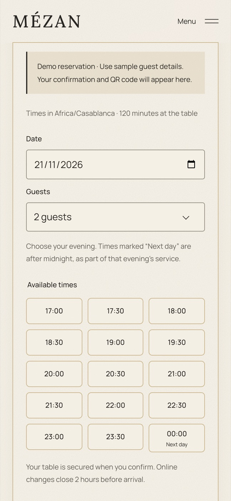
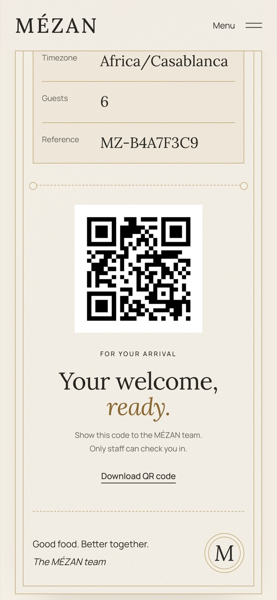
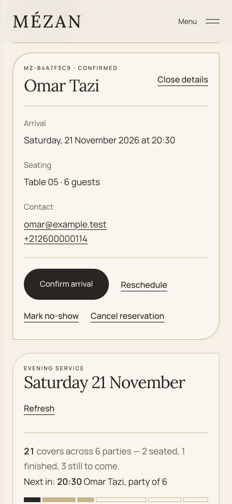
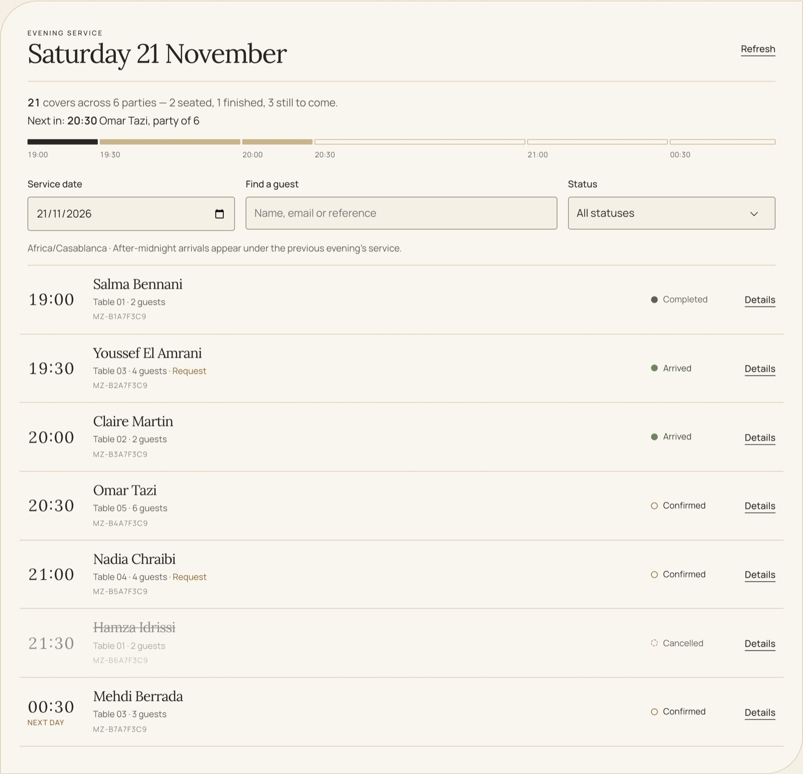

<div align="center">

# MÉZAN

**A restaurant reservation platform: guests book a table from their phone, get a QR confirmation, and staff check them in at the door.**

[**Live demo →**](https://mezan-mu.vercel.app) &nbsp;·&nbsp; [Staff dashboard](https://mezan-mu.vercel.app/staff) &nbsp;·&nbsp; [Contact](#contact)


</div>

## The problem

Small restaurants often take bookings by phone, Instagram messages or a paper notebook. This leads to double bookings and no-shows, and nobody knows who is actually at the door. MÉZAN replaces all of that with one system. Guests book in under a minute from their phone. The database guarantees a table can never be booked twice. Staff check guests in by scanning a QR code.

## From booking to check-in

<p align="center">
  
  &nbsp;
  
  &nbsp;
  
</p>

1. **The guest books on their phone.** They pick a date, party size and one of the times that are actually free.
2. **They get a QR confirmation.** It shows a booking reference, the QR code, and a private link to reschedule or cancel.
3. **Staff check them in.** Staff scan the QR or type the reference, then confirm arrival.



### Try it yourself

1. Open the [live demo](https://mezan-mu.vercel.app/reservations) and book a table with made-up details.
2. Keep the confirmation open. In the same browser, go to [`/staff`](https://mezan-mu.vercel.app/staff) and sign in with the demo login shown on that page.
3. Find the booking by its reference and confirm arrival. Reload the guest's confirmation, and it now shows **Arrived**.

> The public demo runs entirely in your browser with fictional bookings and simulated email. The full version runs on an Express API, PostgreSQL and a background email worker, all containerized with Docker Compose.

## What I focused on: backend & infrastructure

I built this project to practise backend architecture and DevOps on a real-world problem. I wrote the backend, database and infrastructure myself. I built the frontend with the help of AI tools.

**Data integrity**
- **Double bookings are impossible at the database level.** A PostgreSQL `EXCLUDE USING gist` constraint on each table's time range rejects overlapping reservations. This holds even when two guests submit at the same moment. The check lives in the database, not only in application code.
- **Safe to submit twice.** Every booking request carries an idempotency key, so a double tap or a network retry never creates a second reservation.
- **Correct times across midnight.** Service hours like 17:00–02:00 work properly, including daylight-saving changes. A 01:00 arrival is grouped under the previous evening's service.

**Security**
- Passwords are hashed with scrypt and compared in constant time.
- Session tokens are stored hashed and sent in HttpOnly cookies.
- Guest data waiting in the email queue is encrypted with AES-256-GCM.
- Rate limiting is backed by the database, and all input is validated with Zod.
- Login responses take the same time whether or not an account exists, so attackers can't use them to discover accounts.

**Reliability**
- **Emails can't get lost.** Emails are written to an outbox table and sent by a separate worker process. Jobs are claimed with `FOR UPDATE SKIP LOCKED` and retried up to five times. Staff can re-send failed messages.
- Encrypted scheduled backups, with restore verification in a throwaway database.
- Health checks cover the database, website and email worker.

**DevOps**
- Docker Compose stacks for local, CI, staging and production, with Caddy providing automatic HTTPS.
- GitHub Actions runs linting, API tests, PostgreSQL integration tests and Playwright browser tests (desktop and mobile) on every push.
- A CI job deliberately tampers with a backup to prove the restore check rejects it.
- Deployments: the browser demo on Vercel, and the full stack on Render + Neon.

## Architecture

```text
Browser ──► Next.js ──/api proxy──► Express API ──► PostgreSQL
                                        │
                                        └─ email outbox ──► mail worker ──► SMTP
```

The frontend never receives database or email secrets. All booking rules live in the API and the database. Next.js forwards `/api` calls on the same origin, so staff session cookies stay secure.

| Layer | Tools |
| --- | --- |
| Backend | Node.js 22, Express 5, Zod, PostgreSQL 17, Nodemailer |
| Infrastructure | Docker Compose, Caddy, GitHub Actions, Vercel, Render, Neon |
| Testing | Node test runner, PostgreSQL integration tests, Playwright |
| Frontend | Next.js 16, React 19, CSS, Luxon, QR generation and camera scanning |

## Features

| Area | What it does |
| --- | --- |
| **Reservations** | Live availability by date and party size, contact validation, QR confirmation, private reschedule & cancel links |
| **Staff dashboard** | Secure login, the evening's bookings, guest search, QR check-in, arrival / no-show / completion |
| **Restaurant settings** | Staff edit tables, service hours, notice period, booking window and closed dates without touching code |
| **Email** | Confirmation and change notifications through a queued worker with retries |

## About the source code

This repository is a showcase. The full source code is private. I'm happy to walk through the database design, booking logic and deployment setup in an interview.

## Contact

**Abdelmoula Nemili**: Software engineering student at 1337 (UM6P), looking for a backend / DevOps internship

- Email: [nemiliabdelmoula@gmail.com](mailto:nemiliabdelmoula@gmail.com)
- LinkedIn: [linkedin.com/in/abdelmoula-nemili](https://www.linkedin.com/in/abdelmoula-nemili/)
- GitHub: [@Abnemili](https://github.com/Abnemili)

*All restaurant content, names and bookings in the demo are fictional.*
